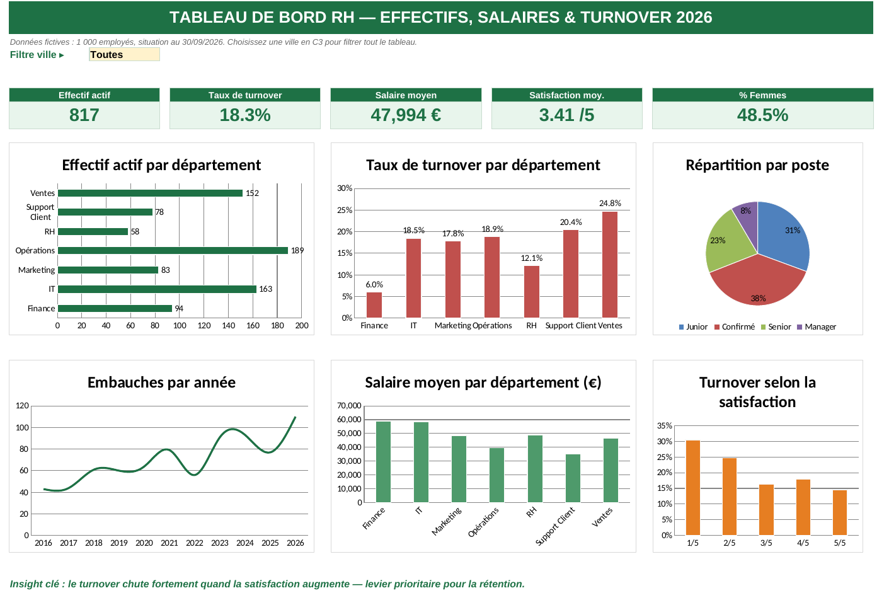
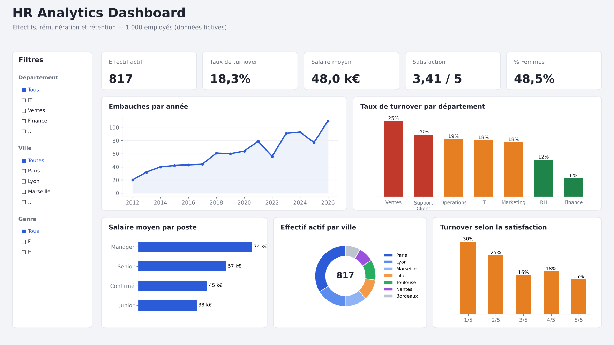
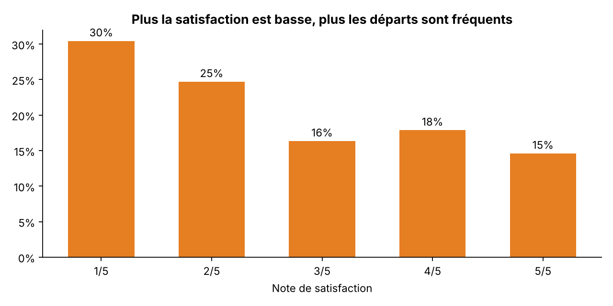

# Portfolio Data Analyst — Analyse RH

**Abdoulaye DIOP** · Data Analyst · [layediop550@gmail.com](mailto:layediop550@gmail.com) · [LinkedIn](https://www.linkedin.com/in/abdoulaye~diop/)

4 projets concrets sur un même jeu de données RH (1 000 employés fictifs) pour transformer des données en décisions sur la **rétention des talents**.

| # | Outil | Projet | Compétences démontrées |
|---|---|---|---|
| 1 | Excel | Tableau de bord RH interactif | COUNTIFS, AVERAGEIFS, liste déroulante de filtre, graphiques dynamiques |
| 2 | SQL | Analyse de la base employés | Agrégations, CASE, jointures, CTE, fonctions de fenêtre (RANK, SUM OVER) |
| 3 | Power BI | HR Analytics Dashboard | Modélisation, table Calendrier, DAX (CALCULATE, USERELATIONSHIP, SWITCH) |
| 4 | Python | Analyse du turnover + rapport PDF | Pandas, Matplotlib, corrélations, génération de rapport avec ReportLab |

## Principaux résultats

- **Turnover global : 18,3 %**, avec un pic dans les **Ventes (24,8 %)** et un minimum en **Finance (6 %)**.
- Les employés **peu satisfaits (1/5) partent 2,1 fois plus** que les très satisfaits (5/5).
- **25 % de départs** chez les employés de moins d'un an : l'onboarding est un levier clé.
- L'écart salarial femmes/hommes reste **inférieur à 5 %** à chaque niveau de poste.

## Structure du dépôt

```
data/
  employes.csv              Jeu de données (1 000 employés, 15 colonnes)
  generate_data.py          Script de génération des données
1_excel/
  Dashboard_RH.xlsx         Tableau de bord (filtre ville en C3)
  apercu_dashboard.png
2_sql/
  01_schema.sql             Création des tables
  02_analyses.sql           8 requêtes d'analyse commentées
  resultats.md              Requêtes + résultats
  run_sql.py                Charge le CSV dans SQLite et exécute les requêtes
3_powerbi/
  GUIDE_POWERBI.md          Construction pas à pas du rapport
  mesures_DAX.dax           15 mesures DAX
  apercu_maquette.png       Rendu visé
4_python/
  analyse_rh.py             Nettoyage, analyse, graphiques, rapport
  Rapport_Analyse_RH.pdf    Rapport généré (4 pages)
  figures/                  6 graphiques
```

## Aperçus





## Reproduire

```bash
pip install pandas matplotlib openpyxl reportlab tabulate
cd data && python generate_data.py
cd ../2_sql && python run_sql.py
cd ../4_python && python analyse_rh.py
```

*Données entièrement fictives, générées pour ce portfolio.*
